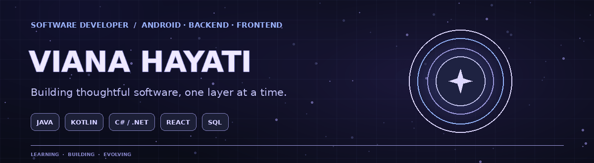
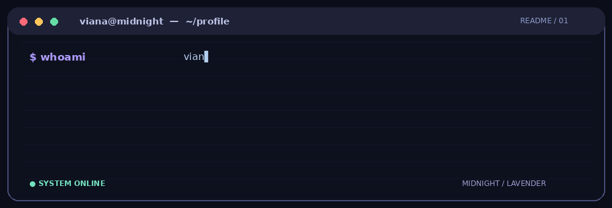

 

---

<h3 align="center">✦ ABOUT ME ✦</h3>

Software developer exploring the space between mobile applications, backend systems, and modern web interfaces.
 
I enjoy understanding how software works beneath the surface — from user interactions to APIs, architecture, and data.

  

---

<h3 align="center">✦ TECHNICAL SKILLS ✦</h3>

<table align="center">
<tr>
<td align="center" width="50%">

**MOBILE DEVELOPMENT**

Android · XML · Material Design · Room

</td>
<td align="center" width="50%">

**BACKEND DEVELOPMENT**

ASP.NET Core · Entity Framework Core · REST APIs

</td>
</tr>
<tr>
<td align="center" width="50%">

**FRONTEND DEVELOPMENT**

Responsive UI · Modern web interfaces

</td>
<td align="center" width="50%">

**DATABASE & TOOLS**

SQL Server · IntelliJ IDEA · Visual Studio

</td>
</tr>
</table>

---

<h3 align="center">✦ CURRENTLY EXPLORING ✦</h3>

  
  
  
  

---

<h3 align="center">✦ GITHUB ACTIVITY ✦</h3>

 

---

### ✧ KEEP BUILDING. KEEP EVOLVING. ✧

VIANA HAYATI · SOFTWARE DEVELOPER

